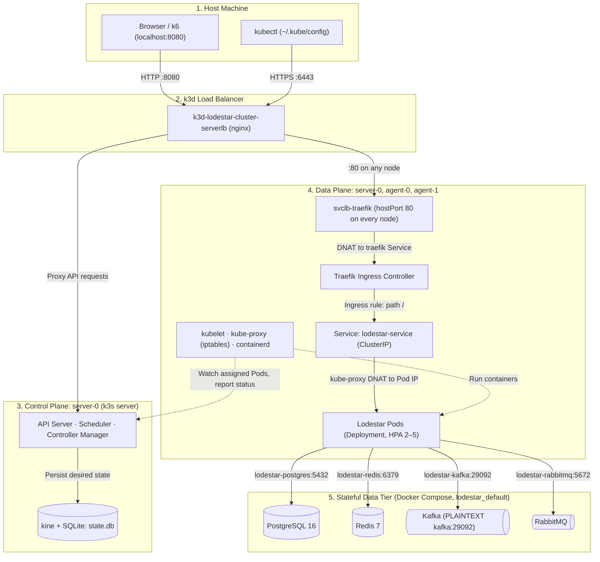
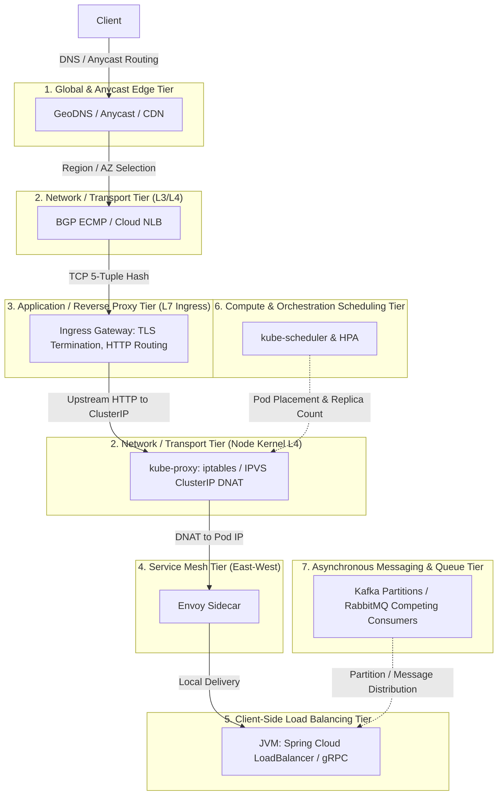

# Kubernetes Deployment & Load Balancing Architecture Guide

This document describes the production-grade containerization, multi-node Kubernetes deployment architecture, and traffic balancing strategies for **Lodestar**.

---

## 1. Local Cluster Topology (`k3d`)

To achieve parity with cloud Kubernetes environments (AWS EKS, GCP GKE) without cloud infrastructure costs, Lodestar deploys to a local **`k3d`** cluster: **k3s** (a single-binary Kubernetes distribution) where every node runs as a Docker container.

### 1.1. Cluster Specifications
* **Control Plane (Server Node):** `k3d-lodestar-cluster-server-0`  
  A single `k3s server` process hosts `kube-apiserver`, `kube-scheduler` and `kube-controller-manager`, plus the node components (`kubelet`, `kube-proxy`, `containerd`). k3s does not taint the server node, so application pods may be scheduled on it as well.
* **Cluster State Store:** with a single server and no `--cluster-init`, k3s persists cluster state in **SQLite** via **kine** (an etcd API shim): `/var/lib/rancher/k3s/server/db/state.db`. Embedded etcd is used only for multi-server HA setups.
* **Worker Nodes (Agent Nodes):** `k3d-lodestar-cluster-agent-0`, `k3d-lodestar-cluster-agent-1`  
  A `k3s agent` process (`kubelet`, `kube-proxy` in iptables mode, Flannel VXLAN) plus its own `containerd` holding the pod containers.
* **k3d Load Balancer:** `k3d-lodestar-cluster-serverlb` (nginx) publishes host port `8080` to port `80` of every node and proxies the API Server (`6443`) to a random host port written into `~/.kube/config`.
* **Built-in k3s Add-ons (`kube-system`):** CoreDNS, Traefik (Ingress Controller), ServiceLB (`svclb-traefik` pods on every node), metrics-server (CPU/RAM metrics for HPA), local-path-provisioner.
* **Footprint:** the empty cluster (system pods only) uses **~1.2 GB of RAM** (`docker stats`: server ~0.9 GB, agents ~0.1 GB each, load balancer ~30 MB); each Lodestar replica adds up to its 1 GiB memory limit.

### 1.2. Network Address Spaces
| Range | Owner | Contents |
|---|---|---|
| `172.18.0.0/16` | Docker bridge `lodestar_default` | k3d node containers and Docker Compose data services |
| `10.42.0.0/16` | k3s pod network (Flannel VXLAN) | Pod IPs; each node receives a `/24` (`podCIDR`) |
| `10.43.0.0/16` | k3s service network | Virtual `ClusterIP` addresses, implemented only as `kube-proxy` iptables rules |

### 1.3. Kubernetes Resources (`k8s/`)
| Manifest | Resource | Key settings |
|---|---|---|
| `configmap.yaml` | ConfigMap `lodestar-config` | Data tier endpoints by Compose container name, alert source, leader election |
| `secret.yaml` | Secret `lodestar-secret` | Database and RabbitMQ credentials, alert API token |
| `deployment.yaml` | Deployment `lodestar` | no `replicas` field (owned by the HPA), topology spread across nodes, `RollingUpdate` (`maxSurge: 1`, `maxUnavailable: 0`), probes, `preStop`, resources (section 3) |
| `service.yaml` | Service `lodestar-service` | `ClusterIP`, port `8080` |
| `ingress.yaml` | Ingress `lodestar-ingress` | Traefik entrypoint `web`, path `/` (Prefix) to `lodestar-service:8080` |
| `hpa.yaml` | HorizontalPodAutoscaler `lodestar-hpa` | 2–5 replicas, CPU 60% (section 5) |
| `pdb.yaml` | PodDisruptionBudget `lodestar-pdb` | `minAvailable: 1` during voluntary disruptions (node drain, cluster upgrade) |

### 1.4. Topology & Request Flow


---

## 2. Pod Topology & Distributed Coordination

### 2.1. Symmetric Stateless Service Replicas
Lodestar follows 12-Factor App design principles. All application replicas deployed via Kubernetes `Deployment` are **symmetric and stateless**:
* Every pod can service incoming REST API requests (`/api/v1/*`).
* Every pod runs Kafka listeners in three consumer groups (`lodestar-group` for alert archiving and subscriber matching, `lodestar-analytics-group` for stream analysis, `lodestar-anomaly-group` for anomaly events) and RabbitMQ consumers for the notification queues; Kafka rebalances topic partitions across replicas automatically.
* Scaling the deployment (e.g., from 1 to 5 pods) creates identical, interchangeable instances without master/worker code divergence.

### 2.2. Distributed Ingestion: The Redis-Backed Leader Election Pattern
While REST and messaging workloads scale horizontally, polling external rate-limited APIs (such as `alerts.in.ua`) requires strict singleton execution:
* **The Problem:** If 5 horizontally scaled pods each poll an external API every 15 seconds, the effective request rate multiplies to once every 3 seconds, triggering immediate `HTTP 429 Too Many Requests` and API token suspension.
* **The Architecture:** Lodestar uses **Redis-Backed Leader Election**:
  * An elected leader lock (`lodestar:leader:alert-ingest`) is acquired using an atomic Redis `SETNX` lease (TTL 20s) renewed by a heartbeat every 7s; the instance ID is the pod name (`HOSTNAME` from the Downward API).
  * Only the active leader pod executes `AlertIngestWorker`.
  * Non-leader replicas remain in hot standby for ingestion while continuing to process incoming HTTP requests and messaging streams.
  * If the leader pod terminates, an active standby replica acquires the lease on the subsequent cycle, ensuring continuous ingestion without duplicate external requests.

### 2.3. Infrastructure Placement Strategy
* **Data & Messaging Tier (PostgreSQL, Kafka, RabbitMQ, Redis):**  
  To optimize memory footprint and avoid running Kubernetes Operators locally, the stateful infrastructure runs in Docker Compose. Kubernetes does not manage or health-check these services; Docker healthchecks do. In cloud environments this mirrors standard practice: data tiers on managed services (AWS RDS, MSK, ElastiCache) while stateless compute runs in Kubernetes.

### 2.4. Network Bridge to the Data Tier
The cluster is created with `--network lodestar_default`, so every k3d node joins the Docker Compose bridge network:
* **Name resolution from pods:** pods query CoreDNS (`kube-dns`, `10.43.0.10`). Compose container names (`lodestar-postgres`, `lodestar-kafka`, ...) are served from the `NodeHosts` entries that k3d injects into the `coredns` ConfigMap at cluster creation; any other name (e.g. the Compose service alias `kafka`) is forwarded to the node resolver `172.18.0.1`, which k3d redirects to Docker's embedded DNS.
* **Kafka advertised listeners:** the broker exposes two listeners. `PLAINTEXT` (`:29092`) advertises `kafka:29092`, resolvable inside the Docker network; `PLAINTEXT_HOST` (`:9092`) advertises `localhost:9092` for applications on the host. Kafka clients use the bootstrap address only to fetch metadata and then connect to the advertised address of each partition leader, so pods must use `lodestar-kafka:29092`; through `:9092` they would connect to their own loopback and fail with `Connection refused`.
* **Source address:** traffic leaving the pod network is masqueraded to the node IP (`172.18.0.x`), so the data tier sees node addresses, not pod IPs.
* **Ordering:** Docker Compose must create `lodestar_default` before `k3d cluster create`; a network created by k3d lacks Compose labels and `docker compose up` refuses to reuse it.

---

## 3. Cloud-Native Containerization & JVM Tuning

### 3.1. Multi-Stage Layered Dockerfile
Spring Boot 3.3 layered jars are leveraged to minimize container build times and registry transfer bandwidth:
1. **Extractor Stage:** Runs `java -Djarmode=tools -jar application.jar extract --layers --launcher` to split the artifact into distinct semantic layers:
   * `dependencies/` (third-party libraries, cached long-term)
   * `spring-boot-loader/`
   * `snapshot-dependencies/`
   * `application/` (application classes and resources, updated frequently)
2. **Runtime Stage:** Built upon `eclipse-temurin:21-jre-alpine` (final image ~300 MB: JRE base plus application dependencies). Runs under a dedicated non-root user (`USER spring:spring`).

### 3.2. Cgroups v2 & Container Memory Awareness
Hardcoding `-Xmx` inside a container is an anti-pattern. Instead, heap size is derived from the cgroup memory limit:
```bash
JAVA_OPTS="-XX:MaxRAMPercentage=60.0 \
           -XX:+UseG1GC \
           -XX:+ExitOnOutOfMemoryError"
```
* **Container awareness:** `-XX:+UseContainerSupport` is enabled by default since JDK 10, so it is not set explicitly; the JVM reads `memory.max` / `cpu.max` from cgroups v2.
* **Heap Boundary:** 60% of the container memory limit (~614 MiB of 1 GiB).
* **Non-Heap Budget:** the remaining ~410 MiB covers Metaspace, Code Cache, thread stacks, GC structures and direct buffers. `limits.memory` caps the whole process (RSS), not just the heap; exceeding it gets the process killed by the kernel (`OOMKilled`, Exit Code 137) without an `OutOfMemoryError`.
* **Explicit GC:** JVM ergonomics selects G1 only on "server-class" machines (>= 2 CPUs and >= 1792 MB). With `limits.cpu: 1000m` the JVM sees one CPU and would silently fall back to SerialGC, so G1 is set explicitly.
* **Fail fast:** `-XX:+ExitOnOutOfMemoryError` terminates the JVM on a Java-level OOM so the kubelet restarts the container instead of leaving it half-alive.
* **Pod resources:** `requests.memory` = `limits.memory` = 1 GiB. Memory is not compressible: with `requests < limits` the scheduler may overcommit a node, and under node memory pressure Burstable pods above their request are the first candidates for eviction or OOM kill.

---

## 4. Reliability & Zero-Downtime Deployments

### 4.1. Health Probes Isolation
Spring Boot Actuator health groups are mapped to Kubernetes probes:
* **Liveness Probe (`/actuator/health/liveness`):**  
  * *Purpose:* Determines if the JVM process is alive and responsive.
  * *Architectural Requirement:* Strictly isolated from external network dependencies (PostgreSQL, Kafka, Redis). If an external database experiences temporary latency, a dependent liveness check would trigger cascading pod restarts across the entire cluster.
* **Readiness Probe (`/actuator/health/readiness`):**  
  * *Purpose:* Determines if the pod is ready to accept incoming customer traffic.
  * *Behavior:* Validates internal component readiness. If negative, the pod IP is removed from the `Endpoints` list of the Kubernetes `Service` without terminating the process.

### 4.2. Graceful Shutdown & The `preStop` Race Condition
When Kubernetes terminates a pod during a deployment rollout or scale-down event, two actions happen asynchronously in parallel:
1. Kubelet runs the `preStop` hook and then sends `SIGTERM` to the container process.
2. The EndpointSlice controller removes the pod IP from the Service endpoints; `kube-proxy` on every node and Traefik then update their routing.

**The Race Condition:** Propagating network rule updates (`iptables` / `IPVS`) across the cluster takes 1 to 4 seconds. If the application terminates immediately upon receiving `SIGTERM`, in-flight requests and new connections routed during this window fail with `502 Bad Gateway` or `Connection Reset by Peer`.

**Production Mitigation:**
```yaml
lifecycle:
  preStop:
    exec:
      command: ["/bin/sh", "-c", "sleep 10"]
```
* The `preStop` hook delays the `SIGTERM` delivery by 10 seconds.
* `kube-proxy` completes route removal across all nodes while the pod continues accepting and finishing active traffic.
* Spring Boot's graceful shutdown (`server.shutdown=graceful` with a 30s phase timeout) then drains remaining requests cleanly before process termination (`Exit Code 143`).
* **Termination budget:** `preStop` (10s) + graceful shutdown (up to 30s) = 40s, within `terminationGracePeriodSeconds: 45`; past that deadline the kubelet sends `SIGKILL`.
* The JVM receives `SIGTERM` directly because the image `ENTRYPOINT` uses `exec`, making `java` PID 1 instead of `sh`.

---

## 5. Horizontal Pod Autoscaling (HPA) & Load Injection

### 5.1. Autoscaler Configuration
An HPA resource (`autoscaling/v2`) targets the Lodestar deployment:
* **Replicas:** 2–5. A floor of two replicas keeps the service available when a node fails or a pod is evicted: with a single replica, a lost node means downtime until the pod is recreated elsewhere, which by default takes up to 5 minutes (`node.kubernetes.io/unreachable` toleration of 300s).
* **Placement:** `topologySpreadConstraints` (`maxSkew: 1` on `kubernetes.io/hostname`, `ScheduleAnyway`) spreads replicas across nodes, so two replicas do not share a single point of failure; `ScheduleAnyway` keeps scheduling possible if a node is unavailable.
* **Voluntary disruptions:** `lodestar-pdb` (`minAvailable: 1`) makes `kubectl drain` and cluster upgrades evict replicas one at a time, never all at once. It does not protect against involuntary failures (node crash, OOMKilled).
* **Metric:** average CPU utilization of 60%, measured against `requests.cpu` (250m), not the limit.
* **Scale-up:** no stabilization window; up to +100% replicas every 15s.
* **Scale-down:** 300s stabilization window; up to −50% replicas every 60s.
* CPU metrics come from metrics-server (bundled with k3s).
* **Replica ownership:** `deployment.yaml` deliberately omits `spec.replicas`. If the manifest set it, every `kubectl apply` would reset the replica count and override the HPA until its next scale-down window.
* **Migrating an existing Deployment:** `kubectl apply` compares the manifest with the `kubectl.kubernetes.io/last-applied-configuration` annotation; removing a field that is still in the annotation deletes it from the object, and the API Server defaults `replicas` to 1. Update the annotation first, then apply:
  ```bash
  kubectl apply set-last-applied -f k8s/deployment.yaml
  kubectl apply -f k8s/deployment.yaml
  ```

### 5.2. Multi-Channel Load Injection
1. **Synthetic Background Event Ingestion:**  
   With `ALERT_SOURCE_TYPE=synthetic`, the leader replica generates simulated alert events into the Kafka `events.raw-alerts` topic.
2. **HTTP Stress Traffic (k6):**  
   `tests/load/k6-spike-test.js` runs a spike profile against the Ingress (`BASE_URL`, default `http://localhost:8080`): 10s warm-up to 10 VUs, 20s ramp to 150 VUs, 30s sustained at 150 VUs, 15s cool-down. Each iteration calls `/api/v1/regions/unrecognized` and `/actuator/health/readiness`; threshold `p(95) < 500ms`.

---

## 6. Cloud Load Balancing Taxonomy & Mechanics

### 6.1. The 7 Infrastructure Layers in Cloud Services
In modern cloud architectures, load balancing is not an isolated component operation; it is an end-to-end multi-tiered cascade where each tier balances traffic under distinct trade-offs between context-awareness and latency overhead:

1. **Global & Anycast Edge Tier:** GeoDNS, Anycast BGP, Cloudflare/CloudFront. Routes incoming internet traffic to the optimal geographical region or availability zone, terminating DDoS and minimizing Round-Trip Time (RTT).
2. **Network / Transport Infrastructure Tier (L3/L4):** BGP ECMP (Equal-Cost Multi-Path), cloud L4 balancers (AWS NLB), Linux IPVS, and node-local `kube-proxy` (iptables/IPVS). Routes raw TCP/UDP packets via 5-tuple hashing at kernel speed ($O(1)$) with near-zero latency, but without inspecting application headers or measuring active in-flight request queues ($L$).
3. **Application / Reverse Proxy Tier (L7 Ingress):** Ingress Controllers (Envoy, NGINX, AWS ALB). Terminates TLS, parses HTTP/1.1, HTTP/2, and gRPC, enforces path/header routing, applies rate limiting and circuit breaking, and dispatches via Least Connections or Power of Two Choices (P2C).
4. **Service Mesh Tier (East-West Inter-Service):** Envoy sidecars (Istio, Linkerd). Balances point-to-point inter-service calls directly between pods, eliminating central gateway bottlenecks while supporting mutual TLS (mTLS) and Outlier Detection.
5. **Client-Side Load Balancing Tier:** Application-level routing embedded in microservices (Spring Cloud LoadBalancer, gRPC subchannel selection). Balances requests inside the JVM process using Service Discovery registries, incurring Zero Network Hops.
6. **Compute & Orchestration Scheduling Tier:** Cluster schedulers (`kube-scheduler`, HPA, CloudSim VM placement). Balances workload placement across physical worker nodes according to multi-dimensional resource vectors (CPU, RAM, topology spread constraints), optimizing multi-objective cost/performance functions ($E = \sum w_i M_i$).
7. **Asynchronous Messaging & Queue Tier:** Partition assignments in Apache Kafka (`CooperativeStickyAssignor`) and task dispatching across competing consumers in RabbitMQ (`basic.qos` / `prefetch_count`).



### 6.2. Layer 4 (Transport Layer) — `kube-proxy`
* **Input:** Raw TCP/UDP packets addressing a `ClusterIP` virtual IP and port.
* **Mechanism:** In-kernel Destination NAT (DNAT). Modifies packet headers without terminating the TCP handshake or inspecting payload contents.
  * *iptables mode:* Evaluates sequential rule chains (`PREROUTING` ➔ `KUBE-SERVICES` ➔ `KUBE-SVC-*` ➔ `KUBE-SEP-*`). Implements random distribution using `--probability`. Scales with algorithmic complexity $O(N)$.
  * *IPVS mode:* Uses Linux kernel IP Virtual Server hash tables ($O(1)$ lookup complexity), maintaining stable latency even with thousands of services.
* **Output:** The original TCP packet rewritten with the destination physical IP of the chosen pod.

### 6.3. Layer 7 (Application Layer) — Ingress / Reverse Proxy
* **Input:** Application protocol streams (HTTP/1.1, HTTP/2, gRPC). Terminates client TLS connections.
* **Mechanism:** Parses HTTP requests, paths, headers, and session identifiers. Evaluates routing rules and opens a separate TCP connection to an upstream backend pod.
* **Output:** A newly assembled HTTP request with injected headers (`X-Forwarded-For`, `X-Request-ID`) transmitted over the upstream socket.

### 6.4. Theoretical Foundations & Mathematical Bounds
The design and evaluation of load balancing strategies across L4 and L7 are rooted in classical distributed systems and queueing theory theorems:

1. **Power of Two Choices Theorem (Mitzenmacher 2001; Azar et al. 1999):**
   * *Randomized Allocation ($d=1$):* Allocating $n$ requests across $n$ pods independently at random (as in iptables `--probability`) yields a maximum queue length of $(1 + o(1))\frac{\ln n}{\ln \ln n}$ with high probability.
   * *Two Random Choices ($d=2$):* Sampling $d=2$ pods uniformly at random and routing to the one with the shorter queue drops the maximum queue length exponentially to $\frac{\ln \ln n}{\ln 2} + \Theta(1)$.
   * *Application:* Explains why L4 random routing suffers under long-lived multiplexed connections, while L7 balancers using P2C achieve near-optimal queue uniformity without centralized state synchronization.

2. **Little's Law (Little 1961):**
   * $L = \lambda W$ (Concurrency = Throughput $\times$ Latency).
   * *Application:* L4 kube-proxy is fundamentally unaware of $L$ (active in-flight requests at the application tier). L7 proxies explicitly track $L$. In high-concurrency spikes, Virtual Threads (Project Loom) enable servicing large $L$ values with minimal heap footprint compared to traditional 1 MB OS platform thread stacks.

3. **Kingman's Formula / VUT Equation (Kingman 1961):**
   * Approximate waiting time in a $G/G/1$ queue:
     $$W_q \approx \left(\frac{c_a^2 + c_s^2}{2}\right) \left(\frac{\rho}{1 - \rho}\right) \frac{1}{\mu}$$
   * *Application:* Quantifies the hyperbolic explosion of queue delay as CPU utilization $\rho \to 1$. Formally justifies Kubernetes HPA target utilization thresholds (e.g., 60% CPU) rather than 90–95%, providing headroom against traffic variance ($c_a^2$).

4. **Universal Scalability Law (Gunther 1993):**
   * $C(N) = \frac{N}{1 + \sigma (N - 1) + \kappa N (N - 1)}$
   * *Application:* Models scaling limits of horizontal pod replication. Least Connections introduces contention delay $\sigma$ and coherency overhead $\kappa$ when coordinating global connection counts across nodes, whereas P2C maintains $\sigma \approx 0$ and $\kappa \approx 0$ via independent local sampling.

5. **CAP / PACELC Asymmetry in Kubernetes:**
   * Kubernetes employs a strict **CP** control plane (etcd via Raft consensus in multi-server clusters; the local single-server k3s uses SQLite via kine) alongside an **AP (Eventual Consistency)** data plane (asynchronous rule distribution to worker nodes via kube-proxy).
   * *Application:* This fundamental distributed systems asymmetry produces the transient propagation window ($\Delta t \approx 1-4$s) during pod termination, necessitating the `preStop: sleep 10` hook to maintain zero-downtime availability.

6. **End-to-End Arguments in System Design (Saltzer, Reed, Clark 1984):**
   * Low-level transport mechanisms cannot fully guarantee end-to-end application correctness. Resilience patterns (retries with idempotency, circuit breakers, fallback degradation) must reside at the application tier (L7) rather than the packet filter level (L4).

---

## 7. Custom Load Balancer Research Prototype

To provide empirical validation for dissertation research and demonstrate deep systems expertise beyond standard Kubernetes abstraction, a companion research prototype (kept outside this repository) designs and benchmarks a **lightweight custom Layer 7 load balancer in Java 21**:

### Architecture
* Built using **Java 21 Virtual Threads (Project Loom)** to handle high-concurrency client sockets with minimal thread overhead.
* Maintains dynamic upstream pools tracking active Lodestar pod instances.

### Supported Algorithms for Comparative Study
1. **Round Robin (RR):** Sequential cyclic dispatch ($1 \rightarrow 2 \rightarrow 3 \rightarrow 1$). Serves as the performance baseline.
2. **Least Connections (LC):** Routes requests to the backend pod with the lowest number of active in-flight requests ($L$). Minimizes instantaneous queue depth at the cost of contention overhead $\sigma$.
3. **Power of Two Choices (P2C / Mitzenmacher 2001):** Selects two upstream candidate pods at random and routes to the one with fewer active connections. Achieves $O(\frac{\ln \ln n}{\ln 2})$ queue bounds without lock contention or the herd effect.

### Benchmark Setup & Empirical Validation
Using `k6` to inject synthetic traffic against the custom balancer, collecting P95 and P99 latency percentiles and upstream request distribution graphs under asymmetric backend load conditions to validate theoretical bounds against empirical measurements.

---

## 8. Step-by-Step Operator Runbook (CLI Reference)

This runbook outlines the exact sequence of commands required to provision, deploy, update, monitor, and teardown the Lodestar cluster environment.

### 8.1. Prerequisites & Required Tools
Install the following lightweight binaries into `~/.local/bin` (no root privileges required):
* `kubectl` (Kubernetes command-line interface)
* `k3d` (Docker-based lightweight Kubernetes cluster manager)
* `k9s` (Terminal UI for cluster inspection and troubleshooting)
* `k6` (Load and performance testing tool)

Ensure `~/.local/bin` is exported in your `PATH`:
```bash
export PATH="$HOME/.local/bin:$PATH"
```

### 8.2. Initial Cluster Provisioning (From Scratch)
1. **Start Stateful Data & Messaging Infrastructure (Docker Compose):**
   ```bash
   cd /home/oleh/workspace/lodestar
   docker compose up -d
   ```
2. **Create Multi-Node k3d Cluster on the Compose Bridge Network:**
   ```bash
   k3d cluster create lodestar-cluster \
     --servers 1 --agents 2 \
     --port "8080:80@loadbalancer" \
     --network lodestar_default
   ```
   *Note:* `--network lodestar_default` attaches the k3d nodes to the Docker Compose network, so pods reach `lodestar-kafka:29092`, `lodestar-postgres:5432`, `lodestar-redis:6379` and `lodestar-rabbitmq:5672` by name and the Kafka advertised listener `kafka:29092` resolves (section 2.4).

3. **Build Application Artifact & Container Image:**
   ```bash
   ./gradlew bootJar
   docker build -t lodestar:latest .
   ```

4. **Import Container Image into k3d Nodes (Eliminates External Registry Push):**
   ```bash
   k3d image import lodestar:latest -c lodestar-cluster
   ```
   *Note:* each node has its own `containerd` image store, separate from the host Docker daemon; `k3d image import` loads the image into every node. The Deployment uses `imagePullPolicy: IfNotPresent`: for the `:latest` tag the default would be `Always`, and the kubelet would try to pull `docker.io/library/lodestar:latest` (`ErrImagePull`).

5. **Apply Kubernetes Manifests:**
   ```bash
   kubectl apply -f k8s/configmap.yaml
   kubectl apply -f k8s/secret.yaml
   kubectl apply -f k8s/deployment.yaml
   kubectl apply -f k8s/service.yaml
   kubectl apply -f k8s/ingress.yaml
   kubectl apply -f k8s/hpa.yaml
   kubectl apply -f k8s/pdb.yaml
   ```

6. **Verify Cluster Readiness:**
   ```bash
   kubectl get nodes -o wide
   kubectl get pods -o wide
   kubectl rollout status deployment/lodestar
   ```

### 8.3. Daily Inner Development Loop (Re-deploying Code Changes)
When code in `lodestar` is modified, execute this fast zero-downtime redeployment pipeline:
```bash
# 1. Compile updated Spring Boot jar
./gradlew bootJar -x test

# 2. Build multi-stage container image
docker build -t lodestar:latest .

# 3. Import updated image into k3d
k3d image import lodestar:latest -c lodestar-cluster

# 4. Trigger rolling restart
kubectl rollout restart deployment/lodestar

# 5. Monitor rolling update status
kubectl rollout status deployment/lodestar
```

### 8.4. Routine Environment Operations (Start, Stop, Restart)
* **Pause Environment (Free Memory & CPU):**
  ```bash
  k3d cluster stop lodestar-cluster
  docker compose stop
  ```
* **Resume Environment:**
  ```bash
  docker compose up -d
  k3d cluster start lodestar-cluster
  kubectl get pods -o wide
  ```
* **Interactive Live Monitoring:**
  ```bash
  k9s
  ```
* **Complete Teardown (Clean Purge):**
  ```bash
  k3d cluster delete lodestar-cluster
  docker compose down -v   # -v also deletes the PostgreSQL, Kafka, RabbitMQ and Redis data volumes
  ```

---

## 9. Empirical Validation & Stress Test Metrics

### 9.1. HPA Spike Stress Test (`k6`)
Executed under high concurrency spike profile using `tests/load/k6-spike-test.js` (measured before the 15.10.2026 resource change: memory requests/limits 512Mi/768Mi, `MaxRAMPercentage=75`):
* **Concurrency:** 150 concurrent Virtual Users (VUs)
* **Duration:** 75 seconds
* **Total HTTP Requests Executed:** 24,202 requests
* **HTTP Failure Rate:** **0.00% (0 errors out of 24,202 checks)**
* **HTTP 502 / Connection Resets:** **Zero (0)**
* **HPA Dynamics** (at that time `minReplicas: 1`; now 2): Automatically scaled the deployment from 1 replica to 5 replicas under 299% peak CPU load, and gracefully scaled down back to 1 replica post cool-down.

### 9.2. Comparative L7 Balancer Benchmark (Project Loom Virtual Threads)
Benchmarked 30 concurrent VUs over 15-second sustained intervals across 3 cluster worker nodes (`172.18.0.6`, `172.18.0.7`, `172.18.0.8`):

| Metric | Round Robin (RR) | Least Connections (LC) | Power of Two Choices (P2C) |
| :--- | :--- | :--- | :--- |
| **Throughput (RPS)** | 325.2 req/s (4,906 reqs) | 375.4 req/s (5,655 reqs) | **563.9 req/s (8,479 reqs)** *(+73%)* |
| **Minimum Latency** | 42.8 ms | 43.1 ms | **1.7 ms** |
| **Average Latency** | 91.9 ms | 79.6 ms | **52.9 ms** |
| **Median (P50)** | 95.5 ms | 87.5 ms | **47.8 ms** |
| **P90 Latency** | 151.3 ms | 104.6 ms | **79.7 ms** |
| **P95 Latency** | 195.8 ms | 111.7 ms | **95.6 ms** |
| **P99 Latency** | 207.9 ms | 195.8 ms | **108.0 ms** |
| **Max Latency** | 307.6 ms | 307.7 ms | **203.7 ms** |
| **Error Rate** | 0.00% | 0.00% | **0.00%** |

**Empirical Conclusion:**  
Mitzenmacher's Power of Two Choices ($d=2$) delivered a **73% throughput gain** and cut **P95 latency by more than half** compared to Round Robin. By sampling two random candidates independently, P2C achieved exponential queue bound minimization without suffering the centralized lock and contention overhead ($\sigma$) inherent in global Least Connections tracking under high concurrency.

